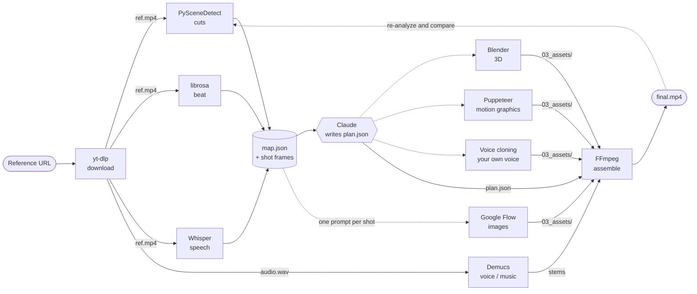

# Complete AI Video Clone Kit

[](https://github.com/jasonmello/complete-ai-video-clone-kit/actions/workflows/ci.yml)
[](LICENSE)

**English** · [Português](#português)

A [Claude Code](https://claude.com/claude-code) skill that turns ten free AI video tools into **one orchestrated pipeline**: give it a reference video, and it measures the structure (where the cuts fall, the beat, the pacing, when people speak), then rebuilds a **new video with your own material** on that same structure.

> **What "clone" means here.** The kit clones the *editing*: shot lengths, cuts on the beat, rhythm and speech timing. It never copies footage, music or voices you don't have the rights to. The reference is something you study, and none of it ends up in your video.

## The 360° view



The loop closes at the end: the finished video goes back through the same analysis, so you can check its numbers against the reference (seconds per shot, % of cuts on the beat).

## The ten tools and how they connect

Each stage writes files with fixed names into one project folder, and the next stage reads them. Because of that contract, any stage can be re-run without redoing the others, and each tool only needs to know its own piece.

| # | Tool | Job in the pipeline | Reads | Writes |
|---|---|---|---|---|
| 1 | **yt-dlp** | Downloads the reference video | a URL | `01_reference/ref.mp4` |
| 2 | **PySceneDetect** | Finds every cut (shot boundaries) | `ref.mp4` | shots in `02_analysis/map.json`, `frames/shot_XX.jpg` |
| 3 | **librosa** | Finds the BPM and each beat, then measures how far each cut is from a beat | `audio.wav` | `beats.json`, beat data in `map.json` |
| 4 | **Whisper** (faster-whisper) | Transcribes speech with word timestamps | `audio.wav` | `transcript.json`, `subtitles.srt`, speech per shot in `map.json` |
| 5 | **Demucs** | Splits the vocals from the music | `audio.wav` | `stems/vocals.wav`, `stems/no_vocals.wav` |
| 6 | **Voice cloning** (any tool you choose) | Narration in **your own** voice | your script | `03_assets/voice/*.wav` |
| 7 | **Google Flow** | Generates the images, one per shot | `prompts.md` that Claude writes from `map.json` | `03_assets/images/shot_XX.png` |
| 8 | **Blender** | 3D shots (a 360° turntable template is included) | a `.glb`/`.fbx`/`.obj` model | `03_assets/3d/` (transparent PNGs) |
| 9 | **Puppeteer** | Renders HTML/CSS motion graphics frame by frame | an HTML page with `window.seek(t)` | `03_assets/motion/*.mp4` or `.mov` with alpha |
| 10 | **FFmpeg** | Assembles everything: camera moves on stills, trims, crop to format, audio mix with ducking | `plan.json` + every asset | `04_render/final.mp4` |

**Claude is the conductor.** It reads `map.json` and the shot frames, writes the Flow prompts and `plan.json`, and decides what goes where. The scripts do the measuring and the rendering.

## Step by step

**1 · Reference.** `download.sh` fetches the video with yt-dlp (H.264, using Node as the JavaScript runtime that YouTube now requires). Only download what you own or have permission to save. Otherwise, drop your own file at `01_reference/ref.mp4` and skip this step.

**2 · Analysis.** `analyze.py` extracts the audio, then:
- PySceneDetect lists every shot.
- librosa finds the beat grid and how many milliseconds each cut sits from a beat.
- Whisper transcribes the speech.

It all merges into `map.json`, plus one still frame per shot, so Claude can *see* what each shot shows. `separate.sh` (Demucs) splits voice and music when you need either one alone.

**3 · Assets.** You make your own material for each shot:
- Images: Flow, from prompts written per shot, all with the same style line.
- 3D: Blender.
- Titles and graphics: Puppeteer.
- Narration: your cloned voice.

**4 · Plan.** Claude writes `plan.json`: one clip per reference shot, each with the reference's duration (nudged onto the beat), plus the audio tracks.

**5 · Assembly.** `assemble.py` turns the plan into a single FFmpeg filter graph. It adds zoom and pan to stills, trims and crops videos to the frame (9:16, 16:9 or 1:1), mixes the audio and ducks the music under the voice.

**6 · Check.** Run `analyze.py --video 04_render/final.mp4` and compare its summary with the reference.

## Install

Requirements: macOS or Linux, [uv](https://docs.astral.sh/uv/), Node 18+. Blender is optional (only for 3D).

**As a Claude Code plugin:**
```
/plugin marketplace add jasonmello/complete-ai-video-clone-kit
/plugin install complete-ai-video-clone-kit@complete-ai-video-clone-kit
```

**Or manually:**
```bash
git clone https://github.com/jasonmello/complete-ai-video-clone-kit.git
ln -s "$PWD/complete-ai-video-clone-kit/skills/complete-ai-video-clone-kit" ~/.claude/skills/complete-ai-video-clone-kit
```

Then install the tools. No sudo, no Homebrew; uv provides Python and an FFmpeg binary:
```bash
bash ~/.claude/skills/complete-ai-video-clone-kit/scripts/doctor.sh
bash ~/.claude/skills/complete-ai-video-clone-kit/scripts/setup.sh
```

## Use

Just talk to Claude:

> "Here's a reel I like: <url>. Make a 9:16 video about my coffee shop with the same rhythm, AI images, and my narration."

Claude runs the stages, shows you the map (shots, BPM, % on the beat), writes the Flow prompts, waits for your images, writes the plan and renders. The plan format and every script option are in [`SKILL.md`](skills/complete-ai-video-clone-kit/SKILL.md).

## What was tested

Verified on macOS (Apple Silicon) on 2026-11-22:
- yt-dlp: a real YouTube download.
- PySceneDetect and librosa: cuts found to the frame on a synthetic edit, 100% on the beat, 117.5 BPM detected for a 120 BPM track.
- Whisper `small`: a correct transcript with timestamps.
- Demucs: two stems.
- FFmpeg assembly: 1080×1920, four clips, ducking.
- Puppeteer: the motion template, using the local Chrome, including `--alpha` (ProRes 4444 with transparency).

CI runs the assembly and the analysis on every push.

**Not verified yet:** the Blender template (Blender wasn't installed), the larger Whisper models, the plugin install command, and Windows.

## Responsible use

- **Structure, not content.** Editing patterns (shot lengths, cutting on the beat) aren't anyone's property. Footage, music and voices are. Don't republish someone else's.
- **Downloading.** Many platforms' terms (YouTube included) don't allow downloading videos you don't own. Use your own files, or videos you have permission to save.
- **Voices.** Clone only your own voice, or a voice whose owner gave written consent. Never use the kit to impersonate a real person or to make misleading content.
- **Automation.** Generate images in Google Flow by hand. Driving Google services with a bot breaks their terms and can get your account suspended.
- **Publishing.** YouTube, TikTok and Instagram require you to label realistic AI-generated content and synthetic voices. Unlicensed music leads to Content ID claims, muted audio or strikes, so use music you own or have licensed.
- **The kit itself** bundles no third-party media and does not bypass DRM or paywalls. CI runs only on synthetic test media.

## License

[Apache-2.0](LICENSE). Redistributions must keep the [NOTICE](NOTICE). The tools the kit calls keep their own licenses. Demucs, Whisper and the rest are installed from their official sources, not bundled.

---

# Português

[English](#complete-ai-video-clone-kit) · **Português**

Uma skill do [Claude Code](https://claude.com/claude-code) que junta dez ferramentas grátis de vídeo com IA num **pipeline só, orquestrado**. Você entrega um vídeo de referência e ela mede a estrutura dele: onde caem os cortes, a batida, o ritmo e quando alguém fala. Depois monta um **vídeo novo, com o seu material**, em cima dessa mesma estrutura.

> **O que "clone" quer dizer aqui.** O kit clona a *edição*: duração dos planos, cortes na batida, ritmo e tempo das falas. Ele nunca copia imagens, música ou vozes sobre as quais você não tem direito. A referência é algo que você estuda, e nada dela vai para o seu vídeo.

## A visão 360°

O diagrama acima (seção em inglês) mostra o ciclo completo. O ciclo fecha no fim: o vídeo pronto passa pela mesma análise, e você compara os números dele com os da referência (segundos por plano e % de cortes na batida).

## As dez ferramentas e como uma se liga à outra

Cada etapa grava arquivos com nome fixo numa pasta de projeto, e a etapa seguinte lê esses arquivos. Graças a esse contrato, dá para refazer qualquer etapa sem repetir as outras, e cada ferramenta só precisa conhecer o seu pedaço.

| # | Ferramenta | Papel no pipeline | Lê | Grava |
|---|---|---|---|---|
| 1 | **yt-dlp** | Baixa o vídeo de referência | uma URL | `01_reference/ref.mp4` |
| 2 | **PySceneDetect** | Acha todos os cortes (limites de cada plano) | `ref.mp4` | planos no `02_analysis/map.json`, `frames/shot_XX.jpg` |
| 3 | **librosa** | Acha o BPM e cada batida, e mede a distância de cada corte até a batida mais próxima | `audio.wav` | `beats.json`, dados de batida no `map.json` |
| 4 | **Whisper** (faster-whisper) | Transcreve a fala com o tempo de cada palavra | `audio.wav` | `transcript.json`, `subtitles.srt`, falas por plano no `map.json` |
| 5 | **Demucs** | Separa a voz da música | `audio.wav` | `stems/vocals.wav`, `stems/no_vocals.wav` |
| 6 | **Clonagem de voz** (a ferramenta que você preferir) | Narração com a **sua** voz | seu roteiro | `03_assets/voice/*.wav` |
| 7 | **Google Flow** | Gera as imagens, uma por plano | o `prompts.md` que o Claude escreve a partir do `map.json` | `03_assets/images/shot_XX.png` |
| 8 | **Blender** | Planos em 3D (vem um modelo de giro 360°) | um modelo `.glb`/`.fbx`/`.obj` | `03_assets/3d/` (PNGs com fundo transparente) |
| 9 | **Puppeteer** | Renderiza motion graphics em HTML/CSS, quadro a quadro | uma página HTML com `window.seek(t)` | `03_assets/motion/*.mp4` ou `.mov` com transparência |
| 10 | **FFmpeg** | Monta tudo: movimento de câmera nas imagens, cortes, enquadramento no formato, mixagem com a música abaixando sob a voz | `plan.json` + todos os assets | `04_render/final.mp4` |

**O Claude é o maestro.** Ele lê o `map.json` e os quadros de cada plano, escreve os prompts do Flow e o `plan.json`, e decide o que vai onde. Os scripts medem e renderizam.

## Passo a passo

**1 · Referência.** O `download.sh` baixa o vídeo com o yt-dlp, em H.264, usando o Node como o runtime de JavaScript que o YouTube agora exige. Só baixe o que é seu ou que você tem permissão para salvar. Fora disso, coloque um arquivo seu em `01_reference/ref.mp4` e pule esta etapa.

**2 · Análise.** O `analyze.py` extrai o áudio e depois:
- o PySceneDetect lista os planos;
- o librosa acha a grade de batidas e quantos milissegundos cada corte está da batida;
- o Whisper transcreve a fala.

Tudo vira o `map.json`, com um quadro de cada plano, para o Claude *ver* o que cada plano mostra. O `separate.sh` (Demucs) separa voz e música quando você precisa de uma das duas sozinha.

**3 · Assets.** Você cria o seu material para cada plano:
- Imagens: no Flow, com prompts escritos plano a plano, todos com a mesma linha de estilo.
- 3D: no Blender.
- Títulos e grafismos: no Puppeteer.
- Narração: com a sua voz clonada.

**4 · Roteiro.** O Claude escreve o `plan.json`: um clipe para cada plano da referência, com a mesma duração (ajustada para cair na batida), mais as faixas de áudio.

**5 · Montagem.** O `assemble.py` transforma o roteiro num único grafo de filtros do FFmpeg. Ele aplica zoom e pan nas imagens, corta e enquadra os vídeos no formato (9:16, 16:9 ou 1:1), mixa o áudio e abaixa a música quando entra a voz.

**6 · Conferência.** Rode `analyze.py --video 04_render/final.mp4` e compare o resumo com o da referência.

## Instalação

Requisitos: macOS ou Linux, [uv](https://docs.astral.sh/uv/) e Node 18+. O Blender é opcional, só para 3D.

**Como plugin do Claude Code:**
```
/plugin marketplace add jasonmello/complete-ai-video-clone-kit
/plugin install complete-ai-video-clone-kit@complete-ai-video-clone-kit
```

**Ou à mão:**
```bash
git clone https://github.com/jasonmello/complete-ai-video-clone-kit.git
ln -s "$PWD/complete-ai-video-clone-kit/skills/complete-ai-video-clone-kit" ~/.claude/skills/complete-ai-video-clone-kit
```

Depois instale as ferramentas. Não precisa de sudo nem de Homebrew: o uv traz o Python e um FFmpeg.
```bash
bash ~/.claude/skills/complete-ai-video-clone-kit/scripts/doctor.sh
bash ~/.claude/skills/complete-ai-video-clone-kit/scripts/setup.sh
```

## Como usar

É só conversar com o Claude:

> "Gostei deste reels: <url>. Faz um vídeo 9:16 da minha cafeteria com o mesmo ritmo, imagens de IA e a minha narração."

O Claude roda as etapas e mostra o mapa (planos, BPM, % de cortes na batida). Depois escreve os prompts do Flow, espera as suas imagens, escreve o roteiro e renderiza. O formato do roteiro e todas as opções dos scripts estão no [`SKILL.md`](skills/complete-ai-video-clone-kit/SKILL.md).

## O que foi testado

Verificado no macOS (Apple Silicon) em 22/11/2026:
- yt-dlp: download real do YouTube.
- PySceneDetect e librosa: cortes achados no quadro exato numa edição sintética, 100% na batida, 117,5 BPM detectados numa faixa de 120 BPM.
- Whisper `small`: transcrição correta, com tempos.
- Demucs: dois stems.
- Montagem no FFmpeg: 1080×1920, quatro clipes, com ducking.
- Puppeteer: o modelo de motion, usando o Chrome local, inclusive o `--alpha` (ProRes 4444 com transparência).

O CI roda a montagem e a análise a cada push.

**Ainda não verificado:** o modelo do Blender (o Blender não estava instalado), os modelos maiores do Whisper, o comando de instalação como plugin e o Windows.

## Uso responsável

- **Estrutura, não conteúdo.** Padrões de edição (duração dos planos, cortar na batida) não são propriedade de ninguém. Imagens, música e vozes são. Não republique as dos outros.
- **Download.** Os termos de muitas plataformas, inclusive o YouTube, não permitem baixar vídeos que não são seus. Use arquivos seus ou vídeos que você tem permissão para salvar.
- **Vozes.** Clone só a sua voz, ou a de quem autorizou por escrito. Nunca use o kit para se passar por outra pessoa ou para criar conteúdo enganoso.
- **Automação.** Gere as imagens no Google Flow à mão. Operar serviços do Google com robô quebra os termos deles e pode suspender a sua conta.
- **Publicação.** YouTube, TikTok e Instagram exigem um rótulo em conteúdo realista feito com IA e em vozes sintéticas. Música sem licença gera reivindicação do Content ID, áudio silenciado ou strike, então use música sua ou licenciada.
- **O kit em si** não traz mídia de terceiros e não burla DRM nem paywall. O CI só usa mídia de teste sintética.

## Licença

[Apache-2.0](LICENSE). Redistribuições precisam manter o [NOTICE](NOTICE). As ferramentas que o kit chama mantêm as próprias licenças. Demucs, Whisper e as outras são instaladas das fontes oficiais, não vêm embutidas.
